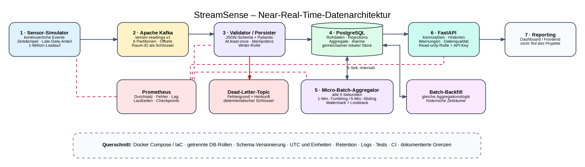

# StreamSense – Near-Real-Time-Backend für Raumluftdaten

StreamSense ist ein lokal reproduzierbares Portfolio-Projekt für **Aufgabe 2** des Kurses *Projekt: Data Engineering (DLMDWWDE02)*. Ein Simulator erzeugt kontinuierlich synthetische Raumluftdaten. Kafka nimmt die Ereignisse auf, ein Persister validiert und speichert sie, ein regelmäßig laufender Aggregator berechnet Zeitfenster, und FastAPI stellt die Ergebnisse für ein späteres Reporting bereit. Das Dashboard selbst gehört nicht zum Projekt.



## Fachliche Einordnung

Das Projekt verwendet den Begriff **Near Real Time** bewusst. Die Aufnahme über Kafka erfolgt kontinuierlich. Die Fenster werden jedoch nicht direkt in einem Kafka-Stream-Prozessor berechnet, sondern alle fünf Sekunden aus den bereits in PostgreSQL gespeicherten Rohereignissen neu aufgebaut. Die Architektur besteht daher aus:

**kontinuierlicher Streaming-Ingestion + persistierter Rohdatenbasis + ereigniszeitbasierter Micro-Batch-Aggregation.**

Diese Lösung ist für einen lokalen Demonstrator nachvollziehbar und gut reproduzierbar. Gleichzeitig wird der Nachteil offen benannt: Der Aggregator liest innerhalb seines Lookbacks wiederholt denselben Rohdatenbereich. Bei hohem Durchsatz muss deshalb besonders auf Datenbanklast und Aggregationsdauer geachtet werden.

Die theoretische Grundlage bilden insbesondere die Kapitel des Studienskripts zu Reliability, Scalability und Maintainability, Stream-Prozessierung und Kafka, Microservices, Governance und Sicherheit sowie DataOps und Containerisierung. Die Projektaufgabe verlangt mindestens eine Million zeitgestempelte Datenpunkte, Windowing, Docker/Microservices, Reproduzierbarkeit und die Betrachtung von Datenschutz, Datensicherheit und Data Governance.

## Datenfluss

1. Der `producer` erzeugt Temperatur-, Feuchte-, CO₂-, Batterie- und Statuswerte.
2. Ein konfigurierbarer Anteil erhält eine ältere Ereigniszeit. Dadurch lässt sich Late Data tatsächlich testen.
3. Kafka speichert die Ereignisse im Topic `sensor-readings.v1`. Die Raum-ID ist der Schlüssel.
4. Der `persister` validiert JSON-Schema und Pydantic-Modell.
5. Gültige Ereignisse werden idempotent in PostgreSQL gespeichert. Ungültige Ereignisse gehen ins Dead-Letter-Topic; Herkunft, Fehlergrund und Payload-Hash werden zusätzlich als Rejection-Audit gespeichert.
6. Der `aggregator` berechnet alle fünf Sekunden Ein-Minuten-Tumbling-Windows und gleitende Fünf-Minuten-Fenster.
7. `api` stellt Kennzahlen, Historien, Warnungen und Datenqualitätswerte schreibgeschützt bereit.
8. Prometheus sammelt technische Metriken.

## Komponenten

| Komponente | Verantwortung |
|---|---|
| `producer` | kontinuierliche Erzeugung synthetischer Ereignisse, Lastlauf und Late-Data-Simulation |
| `broker` | Kafka im KRaft-Modus, Topics, Partitionen, Offsets und Pufferung |
| `persister` | Schema-/Modellvalidierung, DLQ, Rejection-Audit und idempotente Rohdatenspeicherung |
| `postgres` | Rohdaten, Rejections, Aggregate, Alarme, Checkpoints und Schema-Metadaten |
| `aggregator` | Watermark, Lookback, 1-Minuten- und 5-Minuten-Fenster, Warnungen und Retention |
| `api` | ausschließlich lesende Reporting-Schnittstelle mit API-Key |
| `prometheus` | Durchsatz, Fehler, Consumer-Lag, Laufzeiten und technische Zustände |
| `backfill` | wiederholbare Batch-Neuberechnung frei gewählter historischer Zeiträume |

## Bewusster Microservice-Kompromiss

Producer, Persister, Aggregator und API sind getrennte Container und Prozesse mit eigenen Aufgaben. Persister, Aggregator und API verwenden im lokalen Demonstrator jedoch **dieselbe PostgreSQL-Datenbank**. Damit ist die Datenhaltung stärker gekoppelt als bei einem strikten Database-per-Service-Ansatz.

Der Kompromiss wird begrenzt durch:

- getrennte Datenbankrollen mit minimalen Rechten,
- eine ausschließlich lesende API-Rolle,
- klare Tabellenverantwortung,
- versioniertes Schema und dokumentierte Migrationen,
- keine direkte Schreibberechtigung der API.

Für ein größeres Produktivsystem wären getrennte Schemas, eigene Read Models oder tatsächlich getrennte Datenspeicher zu prüfen.

## Voraussetzungen

- Docker Desktop oder Docker Engine mit Docker Compose v2
- ungefähr 4 GB freier Arbeitsspeicher für den vollständigen lokalen Stack
- Git für das eigene Repository
- optional Python 3.12 für lokale Unit-Tests

## Schnellstart

```bash
cp .env.example .env
# Alle Demo-Passwörter und den REPORTING_API_KEY ändern.

docker compose up -d --build
docker compose ps
docker compose logs -f --tail=100 producer persister aggregator api
```

Nach kurzer Anlaufzeit:

```bash
curl http://localhost:8000/health
curl -H "X-API-Key: DEIN_KEY_AUS_DER_ENV" \
  "http://localhost:8000/v1/overview?window=1m"
```

Lokale Oberflächen:

- OpenAPI: `http://localhost:8000/docs`
- Prometheus: `http://localhost:9090`
- Kafka vom Host: `localhost:9092`
- PostgreSQL vom Host: `localhost:5432`

Die Ports sind an `127.0.0.1` gebunden und standardmäßig nur auf dem eigenen Rechner erreichbar.

## Datenbankrollen

Beim ersten Start eines leeren PostgreSQL-Volumes werden folgende Rollen erzeugt:

| Rolle | Rechte |
|---|---|
| `streamsense_admin` | Initialisierung und Administration; nicht an App-Container weitergegeben |
| `streamsense_writer` | Lesen/Schreiben für Rohereignisse und Rejection-Audit |
| `streamsense_aggregator` | Lesen der Rohdaten, Schreiben/Löschen von Aggregaten, Alarmen und Checkpoints |
| `streamsense_reader` | ausschließlich lesender Zugriff für die Reporting-API |

Änderungen an Passwörtern in `.env` wirken auf bereits initialisierte Rollen nicht automatisch. Für den lokalen Demonstrator ist danach ein kontrollierter Reset erforderlich:

```bash
make reset
make up
```

Produktiv wäre eine Passwortrotation ohne Volume-Reset vorzusehen.

## At-least-once und Idempotenz

Der Persister bestätigt Kafka-Offsets erst nach erfolgreicher Datenbanktransaktion. Tritt zwischen Datenbank-Commit und Offset-Commit ein Fehler auf, kann Kafka dieselbe Nachricht erneut liefern. Doppelte Rohdaten werden durch zwei Eindeutigkeitsregeln verhindert:

- `event_id`
- Kombination aus Kafka-Topic, Partition und Offset

Das System bietet damit **At-least-once-Zustellung mit idempotenter Speicherung**, nicht genau-einmalige Ende-zu-Ende-Verarbeitung. Auch DLQ-Ereignisse können nach einem ungünstigen Fehlerzeitpunkt erneut erscheinen. Ihr Schlüssel enthält Topic, Partition und Offset, sodass nachgelagerte DLQ-Verarbeitung deduplizieren kann.

## Windowing und verspätete Ereignisse

- **Tumbling Window:** feste, nicht überlappende Ein-Minuten-Fenster pro Raum
- **Sliding Window:** fünf Minuten Umfang, eine Minute Schrittweite
- **Watermark:** aktuelle UTC-Zeit abzüglich `ALLOWED_LATENESS_SECONDS`
- **Lookback:** der Aggregator berechnet die letzten `AGGREGATION_LOOKBACK_MINUTES` erneut
- **Upsert:** vorhandene Fenster werden vollständig ersetzt und nicht inkrementell aufaddiert

Der Simulator erzeugt standardmäßig bei einem kleinen Anteil der Ereignisse eine ältere `event_time`. Die Werte sind konfigurierbar:

```dotenv
LATE_EVENT_PROBABILITY=0.02
LATE_EVENT_MAX_SECONDS=90
```

Ein konzentrierter Late-Data-Test:

```bash
make late-demo
```

Sehr spät eintreffende Ereignisse außerhalb des regulären Lookbacks bleiben als Rohdaten erhalten. Mit dem Batch-Backfill können historische Zeiträume neu berechnet werden:

```bash
make backfill \
  FROM=2026-08-01T00:00:00Z \
  TO=2026-08-02T00:00:00Z
```

## API-Endpunkte

| Methode und Pfad | Inhalt |
|---|---|
| `GET /health` | Datenbankverbindung, ohne API-Key |
| `GET /v1/overview?window=1m` | Zusammenfassung des neuesten 1- oder 5-Minuten-Fensters |
| `GET /v1/rooms/latest` | neuester Ein-Minuten-Wert pro Raum |
| `GET /v1/rooms/{room_id}/history` | Zeitreihe eines Raums |
| `GET /v1/alerts` | Warnungen und kritische Grenzwertverletzungen |
| `GET /v1/data-quality` | angenommene, auffällige und abgelehnte Ereignisse sowie Quoten |
| `GET /metrics` | Prometheus-Metriken |

Die `/v1`-Endpunkte erwarten den Header `X-API-Key`.

## Eine Million Ereignisse

```bash
make load-1m
```

Der Befehl erzeugt genau 1.000.000 Ereignisse im Burst-Modus. Die tatsächlich erreichbare Laufzeit hängt vom eigenen Rechner ab. Vor der Abgabe müssen daher echte Werte erhoben werden, mindestens:

- Gesamtlaufzeit und mittlerer Durchsatz,
- Zahl gespeicherter und abgelehnter Ereignisse,
- maximaler Consumer-Lag,
- Aggregationsdauer beziehungsweise p50/p95,
- Zahl der erzeugten Fenster und Warnungen,
- Verhalten bei einem absichtlich erzeugten Fehler.

Der vollständige Ablauf kann mit `python scripts/abschluss_test.py` beziehungsweise den Betriebssystem-Startern im Projektstamm automatisiert werden. Die Ergebnisse werden in `docs/TESTERGEBNISSE_AUTOMATISCH.md` und `.json` gespeichert.

## Skalierbarkeit

Kafka verteilt die Daten über sechs Partitionen. Der Persister kann deshalb innerhalb einer Consumer Group horizontal vervielfältigt werden:

```bash
docker compose up -d --scale persister=3
```

Bis zu sechs Persister-Instanzen können für das Eingangs-Topic aktiv arbeiten. Der lokale Stack hat trotzdem klare Grenzen:

- nur ein Kafka-Broker und Replikationsfaktor 1,
- nur eine PostgreSQL-Instanz,
- nur ein Aggregator schreibt gleichzeitig, abgesichert durch eine Advisory Lock,
- wiederholte Datenbankscans innerhalb des Lookbacks,
- keine dynamische Service-Discovery für beliebig viele Monitoring-Ziele.

Der Prototyp zeigt Skalierungsmechanismen, aber keine vollständige Hochverfügbarkeitsarchitektur.

## Reliability und Betrieb

Umgesetzte Mechanismen:

- idempotente Rohdaten und Upserts für Aggregate,
- Kafka-Pufferung und manuelle Offset-Bestätigung,
- persistente Volumes,
- Neustartregeln und Healthchecks,
- Dead-Letter-Topic und Rejection-Audit,
- Advisory Lock für den Aggregator,
- Checkpoints und strukturierte JSON-Logs,
- Prometheus-Metriken,
- Unit-Tests und CI-Workflow.

Die Healthchecks von Producer, Persister und Aggregator prüfen derzeit die Erreichbarkeit ihrer Metrik-Endpunkte. Das ist eine Liveness-Prüfung, aber noch kein vollständiger fachlicher Readiness-Nachweis. Für Produktion wären Grenzwerte für das Alter des letzten erfolgreichen Commits beziehungsweise Aggregationslaufs sinnvoll.

## Datenschutz, Datensicherheit und Data Governance

Der Demonstrator verwendet synthetische Daten und erhebt keine Namen oder direkten Personenkennungen. Bei realen Raumdaten müsste trotzdem geprüft werden, ob zeitliche Muster Rückschlüsse auf Anwesenheit zulassen.

Umgesetzt sind unter anderem:

- Datenminimierung durch einen begrenzten Sensor-Datensatz,
- UTC, definierte Einheiten und versioniertes Schema,
- Herkunft über Topic, Partition und Offset,
- Qualitätsflags und Rejection-Audit,
- konfigurierbare Retention,
- getrennte Rollen und Read-only-API,
- lokale Portbindung und isoliertes Docker-Netzwerk,
- nicht privilegierte, schreibgeschützte App-Container,
- nicht versionierte Secrets in `.env`.

Organisatorische Festlegungen zu Data Owner, Data Steward, Standards und Kontrollen stehen in [`docs/GOVERNANCE.md`](docs/GOVERNANCE.md). Missbrauchs- und Fehlerszenarien stehen in [`docs/SECURITY.md`](docs/SECURITY.md).

Kafka kommuniziert im lokalen Netzwerk unverschlüsselt. Für einen realen Betrieb wären TLS/SASL, getrennte Dienstkonten, Secret-Rotation, Backups und Hochverfügbarkeit nötig.

## Tests

Lokale Python-Umgebung:

```bash
python -m venv .venv
. .venv/bin/activate        # Windows: .venv\Scripts\activate
pip install -r requirements/dev.txt
python -m pytest
python scripts/validate_compose_and_schema.py
```

Der überarbeitete Stand enthält **10 Unit-Tests**. Geprüft werden Modellvalidierung, Generator, reproduzierbare IDs, gezielt verspätete Ereignisse, Fenstergrenzen und JSON-Schema. Der vollständige Containerlauf ist davon getrennt. Für einen kleinen Smoke-Test kann `python scripts/smoke_test.py` genutzt werden. Der automatisierte Abschluss- und Million-Event-Test läuft über:

```bash
python scripts/abschluss_test.py
```

Der aktuelle Validierungsstand steht in [`docs/VALIDIERUNG.md`](docs/VALIDIERUNG.md).

## Projektstruktur

```text
.
├── .github/workflows/ci.yml
├── docker-compose.yml
├── Dockerfile
├── database/
│   ├── init/001_schema.sql
│   ├── init/002_roles.sh
│   └── migrations/README.md
├── docs/
├── ops/prometheus/prometheus.yml
├── schemas/sensor-reading-v1.json
├── scripts/
├── src/streamsense/
│   ├── producer/
│   ├── persister/
│   ├── aggregator/
│   ├── api/
│   └── common/
└── tests/
```

## Portfolio-Unterlagen

Im Ordner `docs/` befinden sich:

- Konzepttext mit genau 200 Wörtern,
- Architekturskizze als PNG,
- Umsetzungstext,
- Kurzabstract mit 40 Wörtern,
- zweiseitige Full-Abstract-Abgabefassung als DOCX und PDF,
- Quellen, Governance- und Sicherheitsbetrachtung,
- technischer Validierungsstand,
- automatisierbares Testprotokoll,
- TXT-Dateien für die GitHub-Links.

Die Abgabefassung enthält keine erfundenen Performancewerte. Hardwareabhängige Ergebnisse können durch den automatischen Abschluss-Test in den Testprotokolldateien dokumentiert werden.

## Eigenes GitHub-Repository

```bash
git init
git add .
git commit -m "Initial StreamSense portfolio project"
git branch -M main
git remote add origin https://github.com/DEIN-BENUTZERNAME/streamsense-realtime-backend.git
git push -u origin main
```

Danach die Linkdateien im Ordner `docs/` aktualisieren.

## Formale Eigenschaften des Full Abstracts

Die DOCX-Datei ist auf Arial formatiert. Die mitgelieferte PDF umfasst genau zwei A4-Seiten, wurde mit einer 300-dpi-Prepress-Einstellung in CMYK konvertiert und enthält eingebettete Schriften. Im bereitgestellten PDF ist Liberation Sans als metrisch kompatible Ersatzschrift eingebettet. Für eine vollständig wortgetreue Umsetzung der Schriftvorgabe kann die DOCX-Datei auf einem System mit installiertem Arial erneut exportiert werden.
